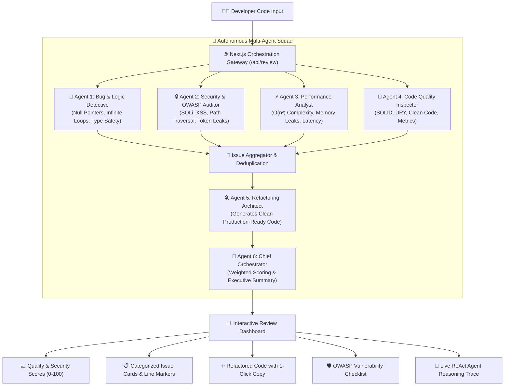

# 🛡️ CodeGuard AI — Autonomous Multi-Agent Code Review & Repair Assistant

<div align="center">

[](https://nextjs.org/)
[](https://react.dev/)
[](https://www.typescriptlang.org/)
[](https://tailwindcss.com/)
[](https://aistudio.google.com/)
[](#-multi-agent-architecture)
[](LICENSE)

**An enterprise-grade, autonomous multi-agent code analysis and automated repair platform built for developers, security teams, and engineering leaders.**

[Live Features](#-key-features) • [Multi-Agent Architecture](#-multi-agent-architecture) • [Specialized Agents](#-meet-the-6-specialized-agents) • [Getting Started](#-getting-started) • [Sample Demos](#-built-in-test-samples)

</div>

---

## 📌 Executive Summary

**CodeGuard AI** revolutionizes modern code reviews by simulating a specialized team of senior software engineers, security researchers, and systems architects. Rather than relying on a single generic LLM prompt, CodeGuard orchestrates **6 autonomous AI agents** operating under the **ReAct (Reasoning + Acting)** framework. 

Each agent focuses on a distinct domain of software engineering—runtime safety, OWASP vulnerabilities, algorithmic complexity, architectural maintainability, automated refactoring, and executive orchestration.

---

## ✨ Key Features

- 🤖 **6 Autonomous AI Agents**: Specialized agents collaborating through an orchestration pipeline to deliver comprehensive reviews.
- 🧠 **Live ReAct Reasoning Trace**: Inspect step-by-step agent thoughts, observations, and tool actions in real time.
- 🛡️ **OWASP Top 10 Security Audit**: Proactive detection of SQL Injection, Cross-Site Scripting (XSS), Path Traversal, SSRF, Hardcoded Secrets, and more.
- ⚡ **Complexity & Performance Profiling**: Detects $O(n^2)$ bottlenecks, memory leaks, unclosed streams, and excessive memory allocations.
- 🔧 **Automated Code Repair (Auto-Refactor)**: Generates complete, drop-in, production-ready replacement code with enhanced error handling.
- 🖥️ **Full-Screen Split IDE**: Modern dark-theme IDE with synchronized line-number scrolling, multi-language syntax support, and responsive panes.
- 🛡️ **Fault-Tolerant Hybrid Engine**: Features a cascading AI model fallback (`gemini-3.8-flash` ➔ `gemini-1.5-flash` ➔ `gemini-2.0-flash-exp`) paired with a deterministic AST/regex rule engine for zero-downtime reliability under rate limits.

---

## 🏗️ Multi-Agent Architecture



---

## 🤖 Meet the 6 Specialized Agents

| # | Agent Name | Domain Focus | Detection Scope |
|---|------------|--------------|-----------------|
| 1 | **Bug & Logic Detective** | Runtime Stability | Null pointer exceptions, undefined references, infinite loops, off-by-one errors, unhandled promise rejections. |
| 2 | **Security & OWASP Auditor** | Application Security | SQL Injection, XSS, Path Traversal, SSRF, hardcoded credentials, unvalidated inputs, insecure deserialization. |
| 3 | **Performance Analyst** | Efficiency & Scaling | $O(n^2)$ nested loops, memory leaks, unclosed database/file streams, N+1 query patterns, excessive garbage collection. |
| 4 | **Code Quality Inspector** | Maintainability & Style | SOLID principles, DRY violations, cognitive complexity, bad variable naming, missing docstrings, dead code. |
| 5 | **Autonomous Refactorer** | Code Synthesis | Re-architects vulnerable code into clean, modular, production-ready code with robust error handling and type safety. |
| 6 | **Chief Orchestrator** | Synthesis & Scoring | Aggregates findings, computes multi-dimensional scores (0–100), filters duplicates, and compiles executive priorities. |

---

## 🧪 Built-in Test Samples

CodeGuard includes one-click presets to demonstrate multi-agent detection across different languages:

| Demo Preset | Language | Targeted Vulnerabilities & Issues |
|-------------|----------|-----------------------------------|
| **Python Demo** | Python | Infinite loop (`while True`), Path Traversal (`open(filename)`), Hardcoded JWT Secret, Division by Zero. |
| **JavaScript Demo** | JavaScript | SQL Injection via raw template literals (`SELECT * FROM users WHERE id = '${id}'`), DOM-based XSS (`innerHTML`), Unclosed DB connection. |
| **TypeScript Demo** | TypeScript | $O(n^2)$ duplicate search algorithm, `any` type abuses, mutable state side effects, missing return contracts. |

---

## 💻 Tech Stack

- **Framework**: [Next.js 16 (App Router)](https://nextjs.org/)
- **Language**: [TypeScript 5](https://www.typescriptlang.org/)
- **UI & Styling**: [TailwindCSS v4](https://tailwindcss.com/) + Custom CSS
- **AI Engine**: [Google Gemini 3.8 Flash API](https://aistudio.google.com/) via REST endpoints
- **Architecture Pattern**: Multi-Agent ReAct (Reasoning + Acting)
- **Icons & Tooling**: [Lucide React](https://lucide.dev/), PostCSS

---

## 🚀 Getting Started

### Prerequisites

- **Node.js**: v18.18.0 or later installed (`node -v`)
- **npm** or **pnpm** installed
- **Google Gemini API Key**: Free at [Google AI Studio](https://aistudio.google.com/app/apikey)

### Installation & Setup

1. **Clone the repository:**
   ```bash
   git clone https://github.com/your-username/code-review-agent.git
   cd code-review-agent
   ```

2. **Install dependencies:**
   ```bash
   npm install
   ```

3. **Configure Environment Variables:**
   Create a `.env.local` file in the root of the project:
   ```bash
   cp .env.example .env.local
   ```
   Open `.env.local` and paste your Google Gemini API key:
   ```env
   GEMINI_API_KEY=AIzaSyYourActualGeminiApiKeyHere
   ```

4. **Run the Development Server:**
   ```bash
   npm run dev
   ```

5. **Open in Browser:**
   Navigate to [http://localhost:3000](http://localhost:3000) to start reviewing code!

---

## 📁 Project Directory Structure

```
code-review-agent/
├── app/
│   ├── api/
│   │   └── review/
│   │       └── route.ts          # Multi-agent orchestrator & Gemini API backend
│   ├── globals.css               # Global styles, scrollbars, and animations
│   ├── layout.tsx                # App root layout
│   └── page.tsx                  # Main IDE & dashboard view
├── components/
│   ├── AgentThoughtsPanel.tsx    # ReAct reasoning trace viewer
│   ├── CodeEditor.tsx            # Split-screen editor with synchronized gutter line numbers
│   ├── Header.tsx                # Top navigation & system health badge
│   ├── IssueCard.tsx             # Interactive, expandable vulnerability card
│   ├── LandingHero.tsx           # Quick feature introduction
│   ├── LoadingState.tsx          # Real-time multi-agent squad scanning animation
│   ├── RefactoredCodeView.tsx    # Clean side-by-side refactored code output
│   ├── ReviewDashboard.tsx       # Tabbed metrics, issues, and audit dashboard
│   ├── ScoreGauge.tsx            # SVG circular score indicator
│   └── SecurityPanel.tsx         # OWASP compliance status checklist
├── lib/
│   ├── samples.ts                # Built-in one-click test cases (Python, JS, TS)
│   └── types.ts                  # TypeScript definitions for agents & reviews
├── public/                       # Static icons and assets
├── .env.example                  # Environment variable template
├── .gitignore                    # Ensures secrets & builds are never committed
├── package.json                  # Dependencies & scripts
├── postcss.config.mjs            # PostCSS configuration for TailwindCSS v4
└── README.md                     # Documentation
```

---

## 🎯 Engineering & Placement Highlights

> **Key talking points for technical interviews:**

1. **Multi-Agent Specialization vs. Monolithic LLM**:
   - Single-prompt approaches often suffer from attention degradation and miss subtle security issues when asked to simultaneously fix style and performance. CodeGuard splits responsibilities among distinct domain specialists before synthesizing the final output.
2. **ReAct (Reasoning + Acting) Observability**:
   - Users can audit *why* an agent made a decision by reviewing the internal chain of thoughts and observations in the "Agent Reasoning" panel.
3. **Resilience & Graceful Degradation**:
   - Implements automated multi-tier fallback routing across Gemini models (`gemini-3.8-flash` ➔ `gemini-1.5-flash` ➔ `gemini-2.0-flash-exp`) combined with local AST/regex pattern audits to withstand API rate limits (HTTP 429).
4. **Synchronized IDE Mechanics**:
   - Engineered synchronized scrolling between the line-number gutter and the code textarea using React `ref` synchronization to handle large files smoothly.

---

## 📄 License

Distributed under the MIT License. See `LICENSE` for more information.

---

<div align="center">
  <b>Built with ❤️ using Next.js & Google Gemini</b>
</div>
